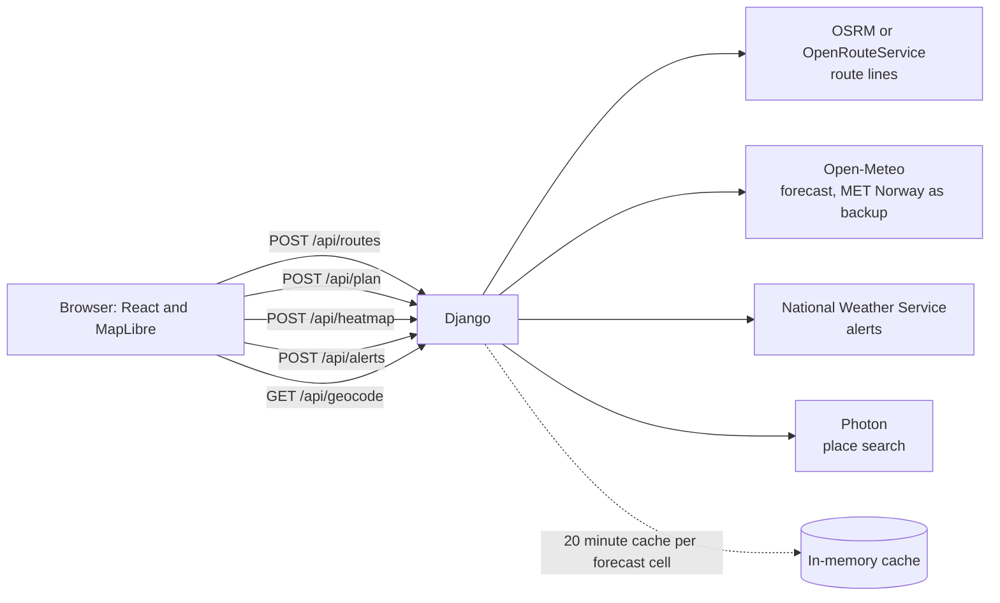

# Weather-aware truck routing

You tell the app where a truck is going, when it leaves and how heavy it is. It finds three routes, checks the forecast at the time the truck will actually be there, and tells you which route has the least dangerous weather. A map shows all three routes, and a heatmap with a 48 hour slider shows how the weather moves along the way.

**Live app:** https://spotter-web-ivory.vercel.app (API at https://spotter-api-three.vercel.app)

Frontend is React and TypeScript. Backend is Django. There is no database, so the backend keeps nothing between requests.

## Running it

You need Python 3.11+ and Node 18+.

```bash
# backend
cd backend
pip install -r requirements.txt
python manage.py test routing      # 47 tests, the weather, routing and alert APIs are faked
python manage.py runserver 8000
```

```bash
# frontend, in a second terminal
cd frontend
npm install
npm test                           # 15 unit tests for the risk, verdict and load logic
npm run dev                        # http://localhost:5173, /api goes to port 8000
```

Nothing needs an API key. If you do have an OpenRouteService key, set `ORS_API_KEY` and routing switches to their truck profile, which knows about weight limits.

## How the pieces fit



Order of events for one trip: the browser asks for the route lines first and draws them on the map within a second or two. Then `/api/plan` fetches the forecast once per ~11 km cell, works out when the truck reaches each checkpoint, scores the risk, ranks the routes, and also scans departures every 3 hours for the best time to leave. The heatmap and the alerts load afterwards without blocking the answer.

## How it decides

**Routes.** I ask OpenRouteService (if there is a key) or the public OSRM server for alternatives. If that gives fewer than three usable routes, I make more by steering through a point off to the side of the main road. A route is thrown out if it is almost the same as one I already have (more than 85% overlap), if it is more than 1.6 times as long as the fastest, or if it goes out and doubles back.

**Timing.** The routing engines assume car speeds, so I cap every segment at 65 mph. There is an optional Hours of Service switch: a 30 minute break after 8 hours of driving and a 10 hour rest after 11. I kept this on by default because it matters. A truck that sleeps for 10 hours meets a different forecast than one that drives straight through.

**Weather.** Open-Meteo hourly forecast, one batched request per 50 locations. Wind is blended between the two nearest hours. Rain and snow use the hour the truck arrives in, because Open-Meteo reports rain as the total of the previous hour. I classify the sustained wind speed, not gusts. Gusts are fetched and shown in the data, but the brief says "wind", so the level follows the steady speed.

**Risk.** Each checkpoint gets the worst of four things: wind, rain, snow and the load rule (heavy trucks in strong wind). The thresholds are straight from the brief, in `backend/routing/domain/risk.py`. The table's ranges share end points, so I made lower bounds inclusive: exactly 35 mph is High, and exactly 0.25 in/hr of rain is High. No Travel follows the table's own wording, so 55 mph wind is No Travel but exactly 1.00 in/hr of rain is still Severe.

**Miles per level.** Each checkpoint covers the road halfway to its neighbours, so the miles in each risk level add up to the real route length.

**The recommendation.** Fewest Severe miles, then fewest High miles, then lowest average risk, then shortest time. One thing I added: No Travel miles are compared before Severe, since No Travel is worse than Severe. If every route hits No Travel at some point, the app still picks the least bad one and tells the driver to think about leaving later. The reason sentence on screen says which rule decided it.

**The heatmap.** The server samples a coarse grid around the corridor for 49 hours. The browser paints one pixel per grid cell on a small canvas, smooths it up and hands it to the map as a single image. Because the grid is regular in Web Mercator, it lines up with the basemap. Scrubbing the slider only redraws that small canvas.

## What you see

The first visit opens a live sample trip (Seattle to Salt Lake City), so the page proves itself before you type anything. "Plan your own" clears it.

- **A plain answer.** A pill at the top says Good to go, Go with care, Better to wait, or Do not go, with the reason. If waiting helps, a button offers the better departure ("Leave Sat 3 AM instead").
- **Best time to leave.** I re-run the whole trip for departures every 3 hours over the next 36 and show the result as bars. One click replans for that time. This is the feature the best weather-routing apps are built around, so I built it on the server, with one forecast fetch for all of them.
- **Official alerts.** National Weather Service alerts are checked along the recommended route and listed with their miles and end times. They also appear as pins on the map, and a Severe or Extreme warning stops the verdict from saying "Good to go".
- **What if the load changes?** If weight changes the answer on the day, a small list shows the verdict for 20k, 30k, 40k, 45k and 60k lb. It uses the same load rule as the backend, applied to the forecast already on screen, so it is instant.
- **Three routes at a glance.** Each card has a ribbon with one cell per checkpoint. Below them, a chart shows wind, rain, snow or risk by mile for all three routes at once, and hovering it compares them at any mile.
- **The map.** Streets, Satellite (USGS, US only) or Dark. The selected route is coloured by risk. Wind, Rain and Snow buttons change the heatmap, the route colour, the checkpoint dots and the ribbons together. On the Wind layer, animated streaks flow the way the wind blows.
- **Forecast timeline.** Play it or drag it across 48 hours. Bars above the slider show the worst conditions on the corridor for each hour. A truck marker per route moves with the slider, a line says what the selected truck is doing and driving through, and "Follow truck" keeps the camera on it.
- **Take it with you.** Share the trip as a link, or print a one-page driver briefing with the stops, alerts and a table of every checkpoint.
- **Check the logic.** "Why Route A?" opens the ranking table, one rule per row, with the deciding rule marked. "How is risk scored?" shows the brief's threshold table.
- **Hover the map.** With the forecast on, the weather under your cursor at the slider time shows in a small tooltip.
- **Keyboard.** Space plays, the arrow keys step the forecast, `[` and `]` switch layers, A, B and C pick a route, `/` jumps to the From field, `P` shows frame rate and timings, `?` lists them all.
- **Phones.** The panel is a bottom sheet you drag between three heights. At the lowest it shows a one-line summary.

## API

- `GET /api/geocode?q=`
- `POST /api/routes` takes the same body as `/api/plan` and returns just the route lines, fast, for the first draw
- `POST /api/plan` (the response also carries `departures`: the best route's risk for each departure in the next 36 hours) with `origin`, `destination`, `departure` (ISO time with offset), `load_lbs`, `interval_mi` (10, 25 or 50) and `hos`
- `POST /api/heatmap` with `corridor`, `start_ts` and `load_lbs`. Returns risk, wind, rain, snow and wind direction for 49 hours
- `POST /api/alerts` with up to 16 `{lat, lon, mile}` points, returns the active weather alerts along them

Errors always look like `{"error": "...", "details": {...}}`. Departure has to be between an hour ago and 7 days ahead, because Open-Meteo gets unreliable past that. If Open-Meteo says it is rate limited, you get a 503 and a message asking you to wait a minute, instead of a vague failure.

## How fast it is

I measured the heatmap on a trip with 102 checkpoints in Chrome: 120 slider frames, median 16.7 ms, slowest 19.7 ms, so it holds 60 fps. Hovering rows of the checkpoint table used to take 25.8 ms per frame because it re-rendered the whole app; the highlight now goes straight to the map and takes 16.7 ms. The first JavaScript is about 61 KB gzipped. The map library (about 224 KB gzipped) loads as its own chunk so the form is usable before the map arrives. axe-core finds no accessibility violations on the results screen. I have not tested on a real phone, only a phone-sized browser window.

## Deploying to Vercel

1. Deploy `backend/` as its own project. Set `DJANGO_SECRET_KEY` and, if you have one, `ORS_API_KEY`.
2. Put the backend's URL into `frontend/vercel.json` where it says `YOUR-BACKEND.vercel.app`, then deploy `frontend/`. The frontend forwards `/api` to the backend, so the browser only talks to one origin.

## Things it does not do

- It uses forecasts, not weather alerts or road closures.
- Hours of Service is simplified. It is not a compliance tool.
- The public OSRM server knows nothing about truck height, weight or hazmat rules. An OpenRouteService key fixes that.
- Open-Meteo's free tier has a per-minute limit. Planning many trips back to back can hit it.
- Satellite imagery and weather alerts only cover the US.
- The "Reading the forecast" steps while loading follow typical timing, not live progress, because the server answers in one go.
